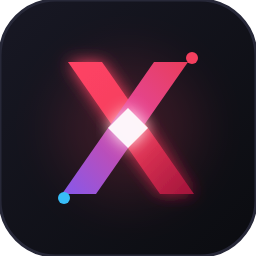

<div align="center">

  

  <h1>✨ XEOO THEME SUITE ✨</h1>

  <p align="center">
    <strong>Studio Tema VS Code: 15 Kategori Warna Utama &bull; 43 Variasi (Dark, Soft, Light)</strong><br/>
    <em>Elevasi UI Penuh (Header, Sidebar, Editor &amp; Footer Berbeda) &bull; Zero Eye-Strain &bull; 1-Click Studio Switcher</em>
  </p>

  <p align="center">
    
    
    
    
  </p>

  <br/>

</div>

---

## ⚡ Apa yang Baru di Versi Ini?

> **"Bukan Sekadar Syntax — Seluruh Antarmuka VS Code Ikut Bertransformasi!"**

Berbeda dengan tema biasa yang hanya mewarnai teks kode, **Xeoo Theme** mendesain ulang arsitektur visual VS Code secara menyeluruh agar setiap zona antarmuka dapat dibedakan dengan jelas dalam sekali lirik:

* 🧭 **Header (Title Bar)**: Warna jangkar atas yang teduh dan tegas memisahkan jendela VS Code dari desktop.
* 📁 **Sidebar (Explorer)**: Latar khusus dengan border pembatas kontras, sehingga batas antara file list dan area koding terlihat sangat tegas (tidak menyatu/membingungkan).
* 📝 **Editor Canvas**: Kanvas utama yang bersih dengan warna kontras terkalibrasi (**WCAG AA 4.5:1 ~ 14:1**), kode angka dan teks variabel tajam tanpa silau.
* 📊 **Footer (Status Bar)**: Menampilkan warna identitas kategori tema dengan teks kontras tinggi dan indikator aktif.
* 📑 **Tabs Aktif**: Tab yang sedang dibuka memiliki aksen garis atas terang dan latar yang langsung menyatu dengan editor.

---

## 🚀 Panduan Pemasangan Manual (Ekstensi Lokal)

> [!NOTE]
> Karena ekstensi ini **belum tersedia di Marketplace Resmi VS Code**, Anda dapat memasangnya secara manual menggunakan berkas installer yang sudah tersedia di proyek ini:

<br/>

### 🌟 CARA 1: Pasang Berkas `.vsix` Melalui VS Code (Paling Cepat)

```
[ Buka VS Code ] ➔ [ Extensions (Ctrl+Shift+X) ] ➔ [ Klik "..." di sudut kanan ] ➔ [ Install from VSIX... ]
```

<details open>
<summary><b>👉 Klik untuk melihat panduan langkah demi langkah</b></summary>
<br/>

1. **Buka Visual Studio Code**.
2. Masuk ke panel ekstensi dengan menekan **`Ctrl + Shift + X`** (atau **`Cmd + Shift + X`** di Mac).
3. Di sudut kanan atas panel Extensions, klik ikon **titik tiga (`...`)** (*Views and More Actions*).
4. Pilih **`Install from VSIX...`**.
5. Pilih berkas **`xeoo-theme-1.0.0.vsix`** yang berada di dalam folder proyek ini, lalu klik **Install**.
6. **Selesai! 🎉** Ikon Xeoo Studio akan langsung muncul di bilah sisi kiri (*Activity Bar*).

> 💡 **Instal Cepat via Terminal:**
> ```bash
> code --install-extension xeoo-theme-1.0.0.vsix
> ```

</details>

<br/>

### 📂 CARA 2: Salin Folder Ekstensi Secara Manual (Import Folder)

<details>
<summary><b>👉 Klik untuk panduan salin direktori</b></summary>
<br/>

Salin seluruh folder ekstensi ini ke direktori ekstensi VS Code di komputer Anda:

* 🪟 **Windows**: `%USERPROFILE%\.vscode\extensions\xeoo-theme`
* 🍎 **macOS**: `~/.vscode/extensions/xeoo-theme`
* 🐧 **Linux**: `~/.vscode/extensions/xeoo-theme`

Setelah disalin, restart VS Code Anda.

</details>

<br/>

### 🧪 CARA 3: Mode Pengujian Cepat (Developer F5)

<details>
<summary><b>👉 Klik untuk panduan Developer Host</b></summary>
<br/>

1. Buka folder proyek ini di VS Code.
2. Tekan tombol **`F5`**.
3. Jendela **Extension Development Host** akan terbuka seketika dengan semua tema yang langsung aktif dan siap dicoba!

</details>

---

## 🎮 Cara Menggunakan Sidebar Xeoo Studio

1. **Buka Studio**: Klik ikon Xeoo di bilah kiri (*Activity Bar*).
2. **Jelajahi 15 Kategori**: Seluruh 15 warna utama tersusun rapi dengan varian **Dark**, **Soft**, dan **Light**.
3. **1-Click Apply**: Klik tema yang Anda inginkan, VS Code langsung berganti tema seketika!
4. **Indikator Aktif**: Tema yang sedang dipakai ditandai dengan lencana **`✦ CURRENT ACTIVE`**.
5. **Pencarian Cepat**: Tekan ikon palet di atas sidebar untuk fuzzy search semua 43 tema.
6. **Surprise Me!**: Tekan ikon bintang ✨ di atas sidebar untuk memilihkan tema acak yang keren!

---

## 🎨 Katalog 15 Kategori Warna (43 Tema)

Setiap kategori dirancang dengan 3 varian:
* **Dark**: Kontras tinggi, kaya warna, presisi untuk ruangan gelap.
* **Soft**: Nada pastel dan muted, sangat nyaman untuk mata yang lelah setelah seharian menatap layar.
* **Light**: Kertas alami anti-silau (*Anti-Glare Paper*) dengan kontras tinta pekat.

<details open>
<summary><b>🔴 1. Red (Merah) — Crimson &amp; Ruby</b></summary>

| Nama Tema | Varian | Header / Sidebar | Footer Bar | Aksen Utama | Karakter Visual |
| :--- | :--- | :--- | :--- | :--- | :--- |
| **Xeoo Red Dark** | Dark | Obsidian Crimson | `#be123c` | `#f43f5e` | Flagship crimson modern, berenergi tinggi. |
| **Xeoo Red Soft** | Soft | Muted Rosé Slate | `#2b1b20` | `#fb7185` | Nuansa merah pastel lembut untuk koding malam hari. |
| **Xeoo Red Light** | Light | Porcelain White | `#be123c` | `#e11d48` | Kertas putih hangat dengan tinta ruby pekat. |

</details>

<details>
<summary><b>🟢 2. Green (Hijau) — Emerald &amp; Sage</b></summary>

| Nama Tema | Varian | Header / Sidebar | Footer Bar | Aksen Utama | Karakter Visual |
| :--- | :--- | :--- | :--- | :--- | :--- |
| **Xeoo Green Dark** | Dark | Deep Pine Green | `#15803d` | `#22c55e` | Matriks zamrud pekat, segar dan menenangkan. |
| **Xeoo Green Soft** | Soft | Herbal Sage Slate | `#1f2d24` | `#4ade80` | Hijau sage pastel ramah mata untuk sesi panjang. |
| **Xeoo Green Light** | Light | Cream Herbal Paper | `#166534` | `#15803d` | Kertas herbal alami dengan tinta pinus pekat. |

</details>

<details>
<summary><b>🔵 3. Blue (Biru) — Sapphire &amp; Cobalt</b></summary>

| Nama Tema | Varian | Header / Sidebar | Footer Bar | Aksen Utama | Karakter Visual |
| :--- | :--- | :--- | :--- | :--- | :--- |
| **Xeoo Blue Dark** | Dark | Abyssal Royal Navy | `#1d4ed8` | `#3b82f6` | Biru safir kerajaan dengan kontras tinggi. |
| **Xeoo Blue Soft** | Soft | Denim Polar Slate | `#1c263c` | `#60a5fa` | Biru denim tenang yang menjaga ketajaman fokus. |
| **Xeoo Blue Light** | Light | Glacier Mist Paper | `#1d4ed8` | `#2563eb` | Kabut es gletser dengan tinta biru kobalt tajam. |

</details>

<details>
<summary><b>🟡 4. Yellow (Kuning) — Canary &amp; Amber</b></summary>

| Nama Tema | Varian | Header / Sidebar | Footer Bar | Aksen Utama | Karakter Visual |
| :--- | :--- | :--- | :--- | :--- | :--- |
| **Xeoo Yellow Dark** | Dark | Dark Umber Slate | `#b45309` | `#eab308` | Kuning kenari kontras tinggi di atas latar gelap. |
| **Xeoo Yellow Soft** | Soft | Honeycomb Slate | `#2f2819` | `#facc15` | Emas pastel madu hangat dan santai. |
| **Xeoo Yellow Light** | Light | Butter Parchment | `#d97706` | `#ca8a04` | Kertas mentega hangat dengan tinta ochre pekat. |

</details>

<details>
<summary><b>⚫ 5. Black (Hitam) — OLED &amp; Obsidian</b></summary>

| Nama Tema | Varian | Header / Sidebar | Footer Bar | Aksen Utama | Karakter Visual |
| :--- | :--- | :--- | :--- | :--- | :--- |
| **Xeoo Black OLED** | Dark | True Black `#000` | `#141414` | `#ffffff` | Hitam pekat sejati khusus layar OLED. |
| **Xeoo Black Soft** | Soft | Matte Obsidian | `#222226` | `#e2e8f0` | Arang obsidian matte yang seimbang dan elegan. |

</details>

<details>
<summary><b>⚪ 6. White (Putih) — Paper &amp; Alabaster (Anti-Glare)</b></summary>

| Nama Tema | Varian | Header / Sidebar | Footer Bar | Aksen Utama | Karakter Visual |
| :--- | :--- | :--- | :--- | :--- | :--- |
| **Xeoo White Paper** | Light | Japanese Parchment | `#292524` | `#44403c` | Kertas perkamen bebas silau dengan tinta Sumi pekat. |
| **Xeoo White Soft** | Soft | Alabaster Slate | `#334155` | `#475569` | Abu-abu alabaster sejuk dengan kontras lembut. |

</details>

<details>
<summary><b>🟣 7. Purple (Ungu) — Amethyst &amp; Twilight</b></summary>

| Nama Tema | Varian | Header / Sidebar | Footer Bar | Aksen Utama | Karakter Visual |
| :--- | :--- | :--- | :--- | :--- | :--- |
| **Xeoo Purple Dark** | Dark | Deep Twilight | `#7e22ce` | `#a855f7` | Ungu amethyst bercahaya bernuansa magis. |
| **Xeoo Purple Soft** | Soft | Lavender Night | `#2a1f3c` | `#c084fc` | Lavender pastel tenang untuk mengurangi ketegangan. |
| **Xeoo Purple Light** | Light | Lilac Cream Paper | `#6b21a8` | `#7e22ce` | Porselen lilac lembut dengan tinta ungu kerajaan. |

</details>

<details>
<summary><b>🟠 8. Orange (Oranye) — Ember &amp; Terracotta</b></summary>

| Nama Tema | Varian | Header / Sidebar | Footer Bar | Aksen Utama | Karakter Visual |
| :--- | :--- | :--- | :--- | :--- | :--- |
| **Xeoo Orange Dark** | Dark | Ember Obsidian | `#c2410c` | `#f97316` | Bara api oranye hangat dan penuh energi. |
| **Xeoo Orange Soft** | Soft | Terracotta Slate | `#332014` | `#fb923c` | Nuansa tanah liat terracotta hangat bersahabat. |
| **Xeoo Orange Light**| Light | Apricot Paper | `#c2410c` | `#ea580c` | Kertas aprikot cerah dengan tinta tembaga gelap. |

</details>

<details>
<summary><b>🌸 9. Pink (Pink) — Sakura &amp; Rose</b></summary>

| Nama Tema | Varian | Header / Sidebar | Footer Bar | Aksen Utama | Karakter Visual |
| :--- | :--- | :--- | :--- | :--- | :--- |
| **Xeoo Pink Dark** | Dark | Midnight Berry | `#be185d` | `#ec4899` | Neon pink elektrik modern di latar gelap. |
| **Xeoo Pink Soft** | Soft | Rose Quartz Night | `#301a2a` | `#f472b6` | Pastel rose quartz lembut ala kelopak sakura. |
| **Xeoo Pink Light** | Light | Cherry Blossom Cream | `#be185d` | `#db2777` | Kertas bunga sakura manis dengan tinta berry. |

</details>

<details>
<summary><b>💠 10. Cyan (Sian) — Aqua &amp; Cyber Cyan</b></summary>

| Nama Tema | Varian | Header / Sidebar | Footer Bar | Aksen Utama | Karakter Visual |
| :--- | :--- | :--- | :--- | :--- | :--- |
| **Xeoo Cyan Dark** | Dark | Cybernetic Aqua | `#0e7490` | `#06b6d4` | Biru cyan futuristik berdaya pancar tinggi. |
| **Xeoo Cyan Soft** | Soft | Seafoam Slate | `#182b30` | `#22d3ee` | Cyan pastel sejuk seperti air laut dangkal. |
| **Xeoo Cyan Light** | Light | Crystal Pool Paper | `#0e7490` | `#0891b2` | Kertas kolam es dengan tinta biru samudra. |

</details>

<details>
<summary><b>🪙 11. Gray (Abu-abu) — Titanium &amp; Slate</b></summary>

| Nama Tema | Varian | Header / Sidebar | Footer Bar | Aksen Utama | Karakter Visual |
| :--- | :--- | :--- | :--- | :--- | :--- |
| **Xeoo Gray Dark** | Dark | Titanium Charcoal | `#27272a` | `#94a3b8` | Abu-abu industri netral tanpa warna pengganggu. |
| **Xeoo Gray Soft** | Soft | Minimal Slate | `#2b2b31` | `#cbd5e1` | Slate netral murni untuk fokus koding maksimal. |
| **Xeoo Gray Light** | Light | Platinum Paper | `#343a40` | `#495057` | Kertas platinum editorial dengan tinta arang tajam. |

</details>

<details>
<summary><b>🔮 12. Indigo (Indigo) — Midnight &amp; Deep Space</b></summary>

| Nama Tema | Varian | Header / Sidebar | Footer Bar | Aksen Utama | Karakter Visual |
| :--- | :--- | :--- | :--- | :--- | :--- |
| **Xeoo Indigo Dark** | Dark | Deep Midnight Space | `#4338ca` | `#6366f1` | Biru nila kosmik pekat berpadu indigo elektrik. |
| **Xeoo Indigo Soft** | Soft | Atmospheric Twilight | `#242347` | `#818cf8` | Indigo pastel teduh untuk mata yang sensitif. |
| **Xeoo Indigo Light**| Light | Silver Mist Paper | `#3730a3` | `#4f46e5` | Kabut perak dengan tinta midnight indigo pekat. |

</details>

<details>
<summary><b>🟤 13. Brown (Cokelat) — Mocha &amp; Walnut</b></summary>

| Nama Tema | Varian | Header / Sidebar | Footer Bar | Aksen Utama | Karakter Visual |
| :--- | :--- | :--- | :--- | :--- | :--- |
| **Xeoo Brown Dark** | Dark | Roasted Dark Mocha | `#78350f` | `#b45309` | Kopi sangrai mocha pekat dengan kehangatan karamel. |
| **Xeoo Brown Soft** | Soft | Coffeehouse Slate | `#2e221b` | `#d97706` | Nuansa kafe roastery santai dan nyaman. |
| **Xeoo Brown Light** | Light | Vintage Book Parchment | `#78350f` | `#92400e` | Perkamen buku antik dengan tinta kenari pekat. |

</details>

<details>
<summary><b>👑 14. Gold (Emas) — Imperial Gold &amp; Amber</b></summary>

| Nama Tema | Varian | Header / Sidebar | Footer Bar | Aksen Utama | Karakter Visual |
| :--- | :--- | :--- | :--- | :--- | :--- |
| **Xeoo Gold Dark** | Dark | Imperial Obsidian | `#b45309` | `#f59e0b` | Emas kerajaan mewah dengan kontras tinggi. |
| **Xeoo Gold Soft** | Soft | Champagne Slate | `#352914` | `#fbbf24` | Emas sampanye lembut yang memanjakan mata. |
| **Xeoo Gold Light** | Light | Ivory Parchment | `#b45309` | `#d97706` | Gading gajah hangat dengan tinta emas amber gelap. |

</details>

<details>
<summary><b>🌊 15. Teal (Hijau Kebiruan) — Deep Sea &amp; Lagoon</b></summary>

| Nama Tema | Varian | Header / Sidebar | Footer Bar | Aksen Utama | Karakter Visual |
| :--- | :--- | :--- | :--- | :--- | :--- |
| **Xeoo Teal Dark** | Dark | Oceanic Trench | `#0f766e` | `#14b8a6` | Palung laut dalam dengan aksen hijau toska sejuk. |
| **Xeoo Teal Soft** | Soft | Lagoon Slate | `#182b27` | `#2dd4bf` | Toska laguna pastel lembut dan menenangkan. |
| **Xeoo Teal Light** | Light | Shallow Reef Paper | `#0f766e` | `#0d9488` | Kertas terumbu karang dangkal dengan tinta toska pekat. |

</details>

---

## 🛠️ Perintah Pengembang

* 🔨 **Build Ulang Tema**:
  ```bash
  npm run build
  ```
* 👀 **Mode Live Watch**:
  ```bash
  npm run watch
  ```
* 📦 **Kemas Installer `.vsix` Baru**:
  ```bash
  npm run package
  ```

---

<div align="center">

  <p>Dikembangkan dengan ❤️ dan dedikasi estetika tingkat tinggi oleh <strong>NTTBELL</strong>.</p>
  <p>Dilisensikan di bawah <a href="LICENSE">MIT License</a>.</p>

  <p><em>Koding lebih menyenangkan, mata tetap nyaman dengan <strong>Xeoo Theme Suite</strong>! 🚀</em></p>

</div>
